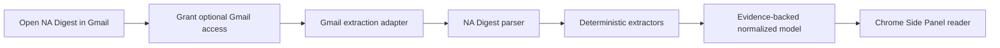

<p align="center">
  
</p>

<h1 align="center">Academic Digest Reader</h1>

<p align="center">
  A privacy-first Chrome Side Panel that turns dense academic digest emails
  into searchable, evidence-backed announcement cards.
</p>

<p align="center">
  <a href="https://github.com/brownzhu/academic-digest-reader/actions/workflows/ci.yml"></a>
  <a href="LICENSE"></a>
  
</p>

Academic Digest Reader reads the currently open Gmail message, parses a
supported newsletter locally, and presents its announcements in a compact
Side Panel. It is designed for long mathematical and scientific mailing-list
digests where deadlines, positions, conferences, software releases, and calls
for papers are otherwise difficult to scan.

> **Current scope:** v0.2.2 supports **NA Digest only**. Unsupported newsletters
> fail explicitly. There is no generic heuristic parser, remote service, AI
> backend, analytics, or inbox-wide collection.

## Highlights

| Capability | Behavior |
| --- | --- |
| Gmail reading | Extracts only the currently open message after user-granted Gmail access |
| Structured parsing | Separates the table of contents, announcements, headers, and footer deterministically |
| Useful fields | Dates, deadlines, URLs, category, salary/funding, and conservative organization/location |
| Transparent relevance | Shows actual matched terms such as `inverse problems · PDE · numerical methods` |
| Evidence | Every populated extracted field retains a rule identifier and source span |
| Reader UI | Search, category filters, deadline/relevance/date sorting, expandable originals, light/dark theme |
| Failure behavior | Displays actionable extraction or parsing diagnostics; never invents missing fields |
| Privacy | Parses in memory, stores only the theme, and contains no application network calls |

## How it works



The Gmail adapter and newsletter parser are intentionally separate. The
adapter locates the visible message using a small set of Gmail DOM selectors.
If one candidate exists, it is selected directly; candidate scoring is used
only when several visible bodies are plausible. The extracted plain text then
passes through the same `NaDigestParser` used by fixtures and tests.

## Install in Chrome

### Build from source

Requirements: Node.js 22.12 or newer and npm.

```sh
git clone https://github.com/brownzhu/academic-digest-reader.git
cd academic-digest-reader
npm ci
npm run check
npm test
npm run build
```

Then:

1. Open `chrome://extensions`.
2. Enable **Developer mode**.
3. Click **Load unpacked** and select the generated `dist/` directory.
4. Open an NA Digest message in Gmail.
5. Click **Academic Digest Reader** in Chrome's extensions menu.
6. On first use, click **Allow Gmail access** and approve Chrome's prompt.

After rebuilding, click the extension card's reload button on
`chrome://extensions` before testing the new build.

## Use the reader

- **Search** across titles, categories, organizations, locations, matched
  keywords, and original announcement text.
- **Filter** for relevant announcements or common categories such as
  conferences, postdocs, PhDs, faculty positions, calls for papers, and
  software.
- **Sort** by original digest order, relevance score, deadline, or event date.
- **Expand** a card to inspect detected dates, links, original text, evidence
  counts, confidence, and warnings.
- **Refresh email** after navigating to another Gmail message.

The standalone Vite preview uses a synthetic fixture because Gmail extension
APIs are available only inside the installed extension.

## Privacy and permissions

| Permission | Why it is used |
| --- | --- |
| `activeTab` | Supports temporary access when Chrome grants it from the toolbar action |
| `scripting` | Runs the small extraction adapter in the active Gmail tab |
| `sidePanel` | Hosts the reader interface |
| `storage` | Stores only the system/light/dark preference |
| Optional `https://mail.google.com/*` | Requested interactively because some Side Panel launch paths do not grant `activeTab` |

There are no mandatory host permissions. Optional Gmail access is restricted
to `mail.google.com` and can be revoked from Chrome's extension settings.
Production JavaScript contains no `fetch`, `XMLHttpRequest`, `sendBeacon`, or
`WebSocket` calls. Announcement links open only after a user click.

See [SECURITY.md](SECURITY.md) for the data boundary and reporting policy.

## Parsing guarantees

- Digest entries require a complete `From` / `Date` / `Subject` header block.
- Long hyphen rules delimit entries; forwarded-message labels do not.
- Wrapped `From` and `Subject` headers are joined only inside the structured
  header block.
- Wrapped table-of-contents lines are joined only when the result exactly
  matches parsed Subject headers in order.
- The table of contents and digest footer cannot become announcements.
- Ambiguous numeric dates are not parsed.
- Organization and location remain `null` unless an explicit supported form,
  currently an `Institution:` line, provides evidence.
- Relevance retains a numerical score internally, but the UI explains it with
  the matched keywords rather than High/Medium/Low labels.

## Development

```sh
npm ci                  # install the locked dependency graph
npm run check           # TypeScript type checking
npm test                # deterministic parser, extraction, state, DOM, and permission tests
npm run build           # emit the unpacked extension to dist/
npm run parse:fixture   # regenerate the normalized synthetic fixture
```

The public regression fixture is synthetic and contains only fictional names,
`example.org` addresses, and synthetic prose. A separate golden manifest fixes
the expected 17 titles so parser changes cannot silently redefine success.

### Project layout

```text
src/
  background/       Side Panel setup and active-tab extraction requests
  extraction/       Gmail DOM adapter and extraction result types
  parsers/          Parser interface, registry, and NA Digest parser
  extractors/       Dates, URLs, compensation, and conservative weak fields
  classification/  Ordered deterministic category rules
  relevance/       Weighted keyword profile and evidence-backed scoring
  reader/           Side Panel rendering, state, filters, sorting, and theme
tests/
  fixtures/         Privacy-safe fixture plus independently maintained golden data
  extraction/       Gmail DOM extraction tests
  parsers/          Golden, malformed-input, and transport-wrapping tests
  reader/           State, DOM startup, interactions, and permission flow tests
```

The current suite contains 42 tests across eight files. The live Gmail adapter
was also audited read-only against a forwarded digest with folded headers; see
[the M3 validation record](docs/M3_VALIDATION.md).

## Adding another newsletter

Add a dedicated parser behind `DigestParser` and register it explicitly. A new
parser should ship with a privacy-safe fixture, a separate golden manifest,
malformed-input tests, and evidence checks. Generic parsing is intentionally
out of scope until multiple real formats establish reliable shared rules.

## Limitations and roadmap

- Gmail markup is not a public stable API; selector maintenance may be needed.
- Only the currently expanded message is read. The extension does not scan the
  inbox or run in the background.
- NA Digest is the only supported newsletter in v0.2.2.
- The project is distributed as an unpacked developer-mode extension and has
  not yet been submitted to the Chrome Web Store.

Likely next steps are additional fixture-driven newsletter parsers, editable
relevance profiles, and a release packaging workflow.

## Contributing

Contributions are welcome. Please read [CONTRIBUTING.md](CONTRIBUTING.md), keep
fixtures synthetic, and run the complete verification sequence before opening
a pull request.

## License

[MIT](LICENSE) © 2026 brownzhu
